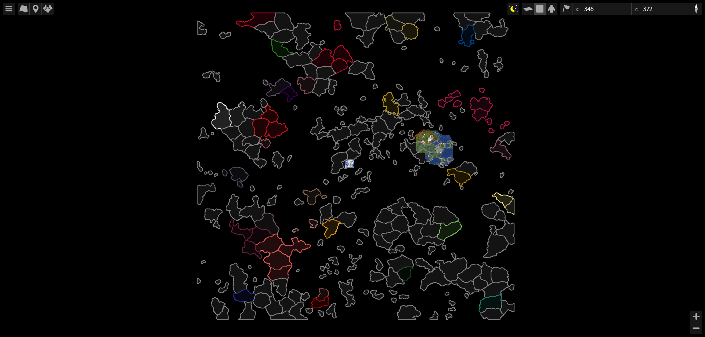
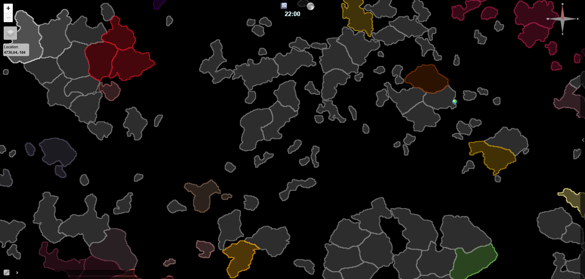
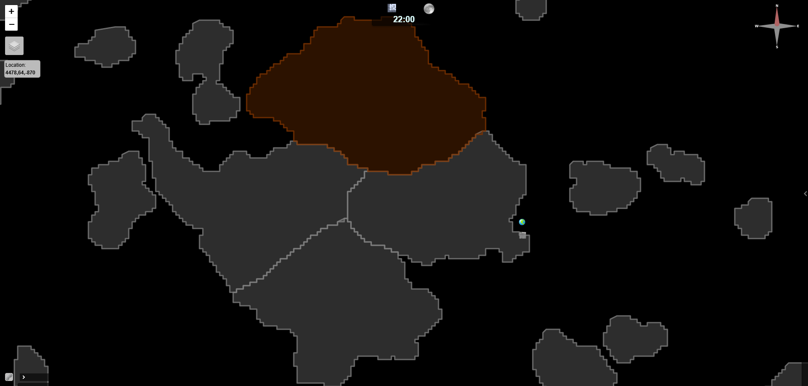

# Image to dynmap/Bluemap converter
Python program that converts an image into markers for Dynmap and BlueMap plugins.  
The program generates two files: world.conf for Bluemap and markers.yml for Dynmap.

# Visual Demonstration
|  | Bluemap | Dynmap |
| -- | ------- | ------ |
| Global |  |  |
| Zoomed in |  |  |

# Instructions
Bluemap  
1. Run main.py
2. Open world.conf and copy its contents
3. Open `.\paper-server\plugins\BlueMap\maps\world.conf`
4. Replace `marker-sets: { }` at the end with the copied data  

dynmap  
1. Run main.py
2. Copy markers.yml
3. Replace `.\paper-server\plugins\dynmap\markers.yml` with copied file  

You may need to change some code to change the settings.  
For example, change `world: Factions` to your own world in `build_dynmap_config`, or adjust the colors for the sea and borders.
